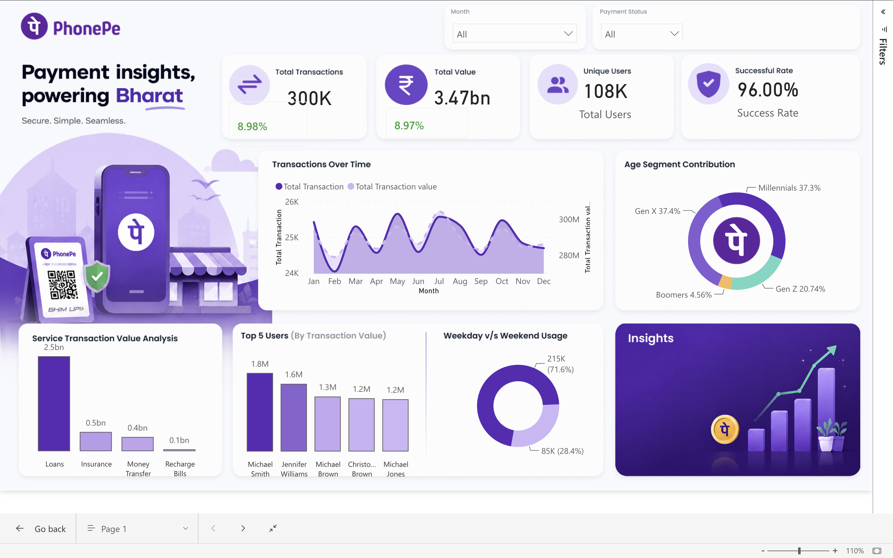

# Digital Payments Analytics Dashboard

An interactive Power BI dashboard developed to analyze digital payment transactions, customer activity, service performance, and transaction trends.

The project follows an end-to-end analytics workflow covering data preparation, transformation, KPI development, data visualization, and business reporting.

## Live Dashboard

[View Interactive Power BI Dashboard](https://app.powerbi.com/groups/me/reports/5305b373-4f22-49e5-bdaa-6d482a2acd7d?ctid=93676573-395b-467d-b4e7-3e73253f9de5&pbi_source=linkShare)

## Dashboard Preview



## Project Overview

The dashboard provides a consolidated view of digital payment activity and enables analysis across transaction trends, customer segments, payment services, and transaction performance.

The analysis covers:

- Transaction volume and transaction value
- Monthly transaction trends
- Payment success rate
- Unique users
- Customer age segments
- Service-wise transaction value
- Top users by transaction value
- Weekday vs. weekend usage

## Technology Stack

- **Power BI Desktop** — Dashboard development and visualization
- **Power Query** — Data cleaning and transformation
- **DAX** — KPI and analytical calculations
- **Excel** — Source data
- **GitHub** — Project documentation and version control

## Data Preparation

The source data was prepared using Power Query before developing the dashboard.

Key preparation steps included:

- Removing duplicate records
- Handling missing values
- Correcting data types
- Standardizing categorical fields
- Creating month and weekday fields
- Creating customer age segments
- Classifying weekday and weekend transactions
- Validating transaction and payment status data

## Data Modeling

The cleaned dataset was structured in Power BI to support analysis across:

- Transactions
- Users
- Payment services
- Payment status
- Transaction dates
- Customer segments

The data model was designed to ensure consistent filtering and interaction across the report.

## Key Performance Indicators

| KPI | Description |
|---|---|
| Total Transactions | Total number of recorded transactions |
| Total Transaction Value | Total monetary value of transactions |
| Unique Users | Number of distinct users |
| Success Rate | Percentage of successful transactions |

## DAX Measures

The dashboard uses DAX measures to calculate key performance indicators.

```DAX
Total Transactions =
COUNTROWS('Transactions')
```

```DAX
Total Transaction Value =
SUM('Transactions'[Transaction_Value])
```

```DAX
Unique Users =
DISTINCTCOUNT('Transactions'[User_ID])
```

```DAX
Successful Transactions =
CALCULATE(
    [Total Transactions],
    'Transactions'[Payment_Status] = "Successful"
)
```

```DAX
Success Rate =
DIVIDE(
    [Successful Transactions],
    [Total Transactions],
    0
)
```

## Dashboard Analysis

### Transaction Trends

The monthly trend analysis tracks changes in transaction activity and transaction value over time, helping identify periods of higher and lower activity.

### Customer Segmentation

Customer activity is analyzed across different age segments to understand their contribution to overall digital payment usage.

### Service Performance

Transaction value is compared across payment services to identify services with higher transaction contribution.

### Top 5 Users

The dashboard highlights the top five users based on transaction value, providing visibility into high-value customer activity.

### Weekday vs. Weekend Usage

Transaction activity is compared between weekdays and weekends to understand customer usage patterns.

## Dashboard Features

- Interactive month filter
- Payment status filter
- KPI cards
- Monthly transaction analysis
- Customer segmentation
- Service performance analysis
- Top 5 user analysis
- Weekday vs. weekend comparison
- Interactive cross-filtering
- DAX-based calculations
- Custom dashboard layout

## Project Workflow

```text
Raw Data
   ↓
Data Cleaning
   ↓
Data Transformation
   ↓
Data Modeling
   ↓
DAX Measures
   ↓
KPI Development
   ↓
Data Visualization
   ↓
Interactive Dashboard
   ↓
Business Insights
```

## Repository Structure

```text
Phonepay-Dashboard-using-PowerBi/
│
├── Screenshots/
│   └── dashboard.png
│
└── README.md
```

## Skills Demonstrated

**Power BI**
- Power Query
- DAX
- Data Modeling
- Interactive Reports
- KPI Development
- Data Visualization

**Data Analytics**
- Data Cleaning
- Data Transformation
- Trend Analysis
- Customer Segmentation
- KPI Analysis
- Business Reporting

## Key Takeaways

The dashboard provides a single view of digital payment performance and customer activity, making it easier to identify transaction trends, high-value users, service contribution, and usage patterns.

The project demonstrates an end-to-end Power BI workflow from **data preparation to business reporting**.

## Resume Description

**Digital Payments Analytics Dashboard | Power BI**

- Developed an interactive Power BI dashboard to analyze digital payment transactions, customer activity, service performance, and payment success rates.
- Cleaned and transformed transaction data using Power Query and developed DAX measures for key performance indicators.
- Built interactive visualizations for transaction trends, customer segments, service-wise transaction value, top users, and weekday/weekend usage.

## Author

**Shaik Azaruddin**

Data Analyst | Power BI | SQL | Python | Excel | Tableau
